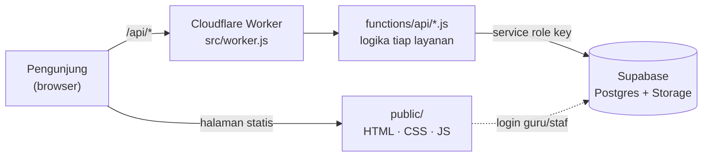

<div align="center">


#  Portal Sekolah — SI-TAQWA

**Sistem Informasi Terpadu SDS Islam At-Taqwa Rawamangun**

Satu website untuk semua kebutuhan sekolah: profil, info terbaru, pendaftaran siswa baru,
buku tamu, pantau belajar anak, hingga administrasi guru & staf.


</div>

---

##  Apa ini?

**Portal Sekolah** adalah website resmi sekaligus sistem layanan digital untuk SDS Islam At-Taqwa Rawamangun.
Satu alamat, banyak layanan. Orang tua, calon murid, tamu, guru, hingga staf punya pintu masuknya masing-masing.

Dibangun **tanpa framework dan tanpa proses build**: halaman memakai HTML/CSS/JavaScript biasa, API berjalan di
**Cloudflare Workers**, dan data tersimpan di **Supabase**. Hasilnya ringan, murah dijalankan, dan mudah dirawat oleh
tim sekolah.

---

##  Layanan yang Tersedia

###  Untuk Publik

| Halaman | Fungsi |
|---|---|
| **Beranda** (`index.html`) | Wajah sekolah: sambutan kepala sekolah, visi, statistik, info terbaru, video, dan galeri prestasi berjalan |
| **Profil Sekolah & Lulusan** | Sejarah, akreditasi, data lulusan, ekskul & club |
| **Guru & Staff** | Daftar pendidik lengkap dengan jabatan, mapel, dan foto (otomatis dari database) |
| **Fasilitas** | Katalog sarana & prasarana dengan pencarian, filter kategori, dan galeri foto |
| **Info Terbaru** | Pengumuman, agenda, dan surat edaran. Tiap info bisa dibagikan ke WhatsApp dengan pratinjau yang rapi |
| **Galeri Prestasi** | Foto-foto prestasi siswa, digabung otomatis dari galeri dan info berkategori Prestasi |
| **Kalender Pendidikan** | Kalender interaktif tahun ajaran 2026/2027 beserta PDF resminya |
| **SPMB** | Informasi jadwal, alur pendaftaran, dan panduan PDF penerimaan murid baru 2027/2028 |
| **Kegiatan Sekolah** | Ekstrakurikuler, club, kegiatan unggulan, dan Jurnal Murid |
| **Pendaftaran Kegiatan** (`daftar.html`) | Pendaftaran terbuka untuk umum lewat tautan khusus, tanpa login |

###  Untuk Orang Tua & Murid

| Halaman | Fungsi |
|---|---|
| **Pantau Belajar Anak** (`ortu.html`) | Masuk dengan kode akses untuk melihat kehadiran, tugas, nilai, karya anak, dan ringkasan kedisiplinan |
| **Pendaftaran Kegiatan** | Mendaftarkan anak ke ekskul/club/kegiatan, termasuk unggah bukti transfer |
| **Jurnal Murid** | Murid mengirim jurnal, lalu admin menyetujuinya sebelum tayang |

###  Untuk Guru & Staf (satu pintu: *Administrasi Guru dan Staf*)

Login memakai **username + PIN**. Menu yang muncul menyesuaikan **peran** masing-masing:

| Peran | Yang bisa dikerjakan |
|---|---|
|  **Guru** | Administrasi kelas: presensi, nilai, tugas, sinkronisasi murid |
|  **Pustakawan** | Desain & cetak **kartu pelajar** (PDF), peminjaman buku, seleksi pendaftar ekskul & club |
|  **Keuangan** | Kas, laporan, proposal, dan LPJ |
|  **Persuratan** | Surat masuk, surat keluar, agenda, dan **pembuat surat otomatis** |
|  **Operator** | Kelola akun guru & staf, data murid (termasuk tempel dari Excel), dan pekerjaan |
|  **BK** | Kedisiplinan + poin + Surat Peringatan, konseling rahasia, surat panggilan orang tua |
|  **Sarpras** | Kelola katalog fasilitas sekolah |
|  **Admin Info** | Kelola Info Terbaru, Galeri Prestasi, dan verifikasi Jurnal Murid |
|  **Admin** | Semua menu |

> Satu orang boleh punya beberapa peran sekaligus. Contoh: wali kelas yang juga guru BK akan melihat
> menu *Kelas* dan *Bimbingan Konseling* berdampingan.

###  Lainnya

- **Buku Tamu Online** — tamu mengetik nama, memilih data yang benar, lalu tanda tangan di layar. Rekap tersimpan terpusat
  dan bisa dilihat dari banyak perangkat.
- **Panel Panitia Kegiatan** (`kegiatan.html`) — membuat kegiatan, membatasi per tingkat kelas, membuka untuk umum, dan
  melihat daftar pendaftar.

---

##  Cara Kerjanya



1. `src/worker.js` adalah **pintu masuk tunggal**. Permintaan `/api/...` diarahkan ke fungsi yang sesuai,
   sisanya melayani file statis dari folder `public/`.
2. Tiap fungsi di `functions/api/` mengurus satu layanan (info, galeri, jurnal, kegiatan, dst.) dan berbicara ke Supabase.
3. Data sensitif (konseling BK, data keuangan, dll.) dilindungi **Row Level Security** di database, sehingga hanya peran
   yang berhak yang bisa membukanya.

---

##  Struktur Folder

```
Portal-Sekolah/
├── public/                  # Seluruh tampilan website (disajikan apa adanya)
│   ├── index.html           #   Beranda (kerangka; logikanya di js/index.js)
│   ├── si-taqwa.html        #   Halaman induk semua layanan
│   ├── kelas.html           #   Administrasi Guru dan Staf (kerangka; logikanya di js/kelas.js)
│   ├── buku-tamu.html       #   Buku Tamu (kerangka; logikanya di js/buku-tamu*.js)
│   ├── ortu.html            #   Pantau Belajar Anak
│   ├── spmb.html            #   Penerimaan murid baru (kerangka; isinya di data-spmb.js, tampilan di js/spmb.js)
│   ├── js/                  #   Skrip bersama & skrip halaman besar
│   │   ├── konfigurasi.js   #     URL & kunci publik Supabase (SATU tempat untuk frontend)
│   │   └── umum.js          #     Pembantu bersama: $ dan esc (jangan dideklarasikan ulang di halaman)
│   ├── css/                 #   Gaya halaman besar (index, spmb, kelas, buku-tamu)
│   ├── modul-*.js           #   Modul menu: staf, BK, surat
│   ├── data-*.js            #   Data yang mudah diubah (sekolah, guru, kalender, SPMB)
│   ├── si-tema.css          #   Tema tampilan
│   └── *.pdf / *.png / *.jpg#   Panduan SPMB, kalender, logo, foto
├── functions/
│   ├── _lib/util.js         # Fungsi bantu bersama (koneksi Supabase, autentikasi, aturan kegiatan)
│   ├── _lib/pembatas.js     # Pembatas percobaan (rate limit), KV opsional
│   └── api/                 # Satu file = satu endpoint API
├── src/
│   └── worker.js            # Router Cloudflare Worker
├── supabase/                # Skrip SQL bernomor (jalankan berurutan; lihat supabase/README.md)
├── tests/                   # Test otomatis (npm test)
├── scripts/                 # Alat bantu pengembangan (cek-frontend.mjs)
├── docs/                    # Ikon README + catatan rilis (PETUNJUK*.txt)
├── CHANGELOG.md             # Ringkasan perubahan
├── package.json             # Perintah dev / deploy / test
└── wrangler.jsonc           # Konfigurasi deploy Cloudflare
```

---

##  Memulai

### Yang dibutuhkan

- Akun [**Cloudflare**](https://cloudflare.com) (Workers) dan [**Supabase**](https://supabase.com) (gratis cukup untuk memulai)
- [Node.js](https://nodejs.org) 20 atau lebih baru (untuk `npm install`, Wrangler, dan test)

### 1. Salin repo

```bash
git clone https://github.com/10kiyo/Portal-Sekolah.git
cd Portal-Sekolah
```

### 2. Siapkan database Supabase

Buka **Supabase → SQL Editor**, lalu jalankan skrip dari folder `supabase/` **sesuai urutan** (urutan penting karena
beberapa skrip bergantung pada skrip sebelumnya):

| # | Skrip | Isi |
|:-:|---|---|
| 0 | `00-info.sql` | Tabel Info sekolah (jalankan paling awal) |
| 0 | `00-kegiatan.sql` | Tabel Kegiatan & pendaftaran (sebelum `03-peran.sql`) |
| 1 | `01-jurnal.sql` | Jurnal Murid |
| 2 | `02-guru.sql` | Tabel guru & staf, username + PIN otomatis |
| 3 | `03-peran.sql` | Peran & aturan akses per peran |
| 4 | `04-foto-guru.sql` | Unggah foto profil guru |
| 5 | `05-kartu.sql` | Profil murid & desain kartu pelajar |
| 6 | `06-kegiatan-tingkat.sql` | Kegiatan per tingkat & pendaftaran umum |
| 7 | `07-ekskul-club.sql` | Pendaftaran ekskul & club |
| 8 | `08-fasilitas.sql` | Katalog fasilitas |
| 9 | `09-bk.sql` | Bimbingan Konseling |
| 10 | `10-peran-info.sql` | Peran Admin Info |
| 11 | `11-galeri.sql` | Galeri Prestasi (bebas urutan) |
| 12 | `12-surat-generator.sql` | Pembuat surat (setelah `03-peran.sql`) |

>  **Jalankan SQL sebelum deploy.** Beberapa kode terbaru sudah memakai kolom baru, sehingga akan error bila tabelnya belum ada.
> Jangan menjalankan ulang `03-peran.sql` atau `08-fasilitas.sql` setelah `09-bk.sql`.

### 3. Atur variabel lingkungan

Di **Cloudflare Dashboard → Workers → portal-sekolah → Settings → Variables**:

| Variabel | Wajib? | Keterangan |
|---|:-:|---|
| `SUPABASE_URL` | Ya | Alamat proyek Supabase |
| `SUPABASE_SERVICE_ROLE_KEY` | Ya | Kunci *service role* Supabase (**rahasia**, hanya di server) |
| `ADMIN_PIN` | Ya | PIN admin utama |
| `ADMIN_SECRET` | Ya | Kata rahasia penanda sesi admin |
| `YOUTUBE_CHANNEL_ID` | Opsional | Menampilkan video terbaru di beranda |
| `GURU_JENIS` | Opsional | Atur manual jenis undangan untuk daftar guru |
| `GURU_EMAIL_DOMAIN` | Opsional | Domain email teknis bila Supabase menolak domain bawaan |

>  **Jangan pernah** memasukkan kunci atau PIN ke dalam kode atau commit Git. `wrangler.jsonc` memakai `keep_vars: true`
> sehingga variabel dari dashboard tetap aman saat deploy ulang.

### 4. Jalankan & deploy

```bash
# Coba di komputer sendiri (buat file .dev.vars berisi variabel di atas)
npm install        # sekali saja
npm run dev

# Tayangkan ke internet
npm run verifikasi # jalankan test & pemeriksaan halaman dulu
npm run deploy
```

Selesai. Website langsung aktif di alamat `*.workers.dev` atau domain sekolah Anda.

---

##  Mengubah Isi Tanpa Menyentuh Kode Rumit

Banyak hal cukup diubah lewat **satu file data**:

| Ingin mengubah… | Buka file | Catatan |
|---|---|---|
| Angka akreditasi, jumlah murid/guru/lulusan, daftar ekskul & club | `public/data-sekolah.js` | Semua halaman ikut berubah otomatis |
| Tanggal libur, ujian, rapor, dan kegiatan | `public/data-kalender.js` | Tambah satu baris `E(...)` per kegiatan |
| Kartu layanan di halaman induk | `public/si-taqwa.html` | Satu kartu `<a class="kt">` = satu layanan |
| Judul dan tagline di beranda | `public/index.html` | Cari komentar `HERO` |
| Teks pita nilai & sambutan kepala sekolah di beranda | `public/js/index.js` | Cari `NILAI` dan `SAMBUTAN` |
| Jadwal, biaya, syarat, dan kontak SPMB | `public/data-spmb.js` | Edit bagian `SPMB` saja; tampilan ada di `js/spmb.js` |
| Foto kepala sekolah | `public/foto-kepsek.jpg` | Timpa dengan nama file yang sama |
| Jabatan, mapel, foto guru, peran | Supabase → tabel `guru_staf` | Tampil di website maksimal ±1 menit |
| Pengumuman & galeri | Panel **Kelola Info & Galeri** | Tersedia untuk akun berperan *Admin Info* |

**Tahun ajaran baru?** Ganti `tahunAjaran`, `pdf`, `bulan`, `hbe`, dan isi ulang daftar `acara` di `data-kalender.js`,
lalu ganti PDF kalender di folder `public/`.

---

##  Catatan Keamanan

- Hak akses diperiksa **di server dan di database (RLS)**, bukan sekadar menyembunyikan menu di layar.
- Catatan konseling BK hanya bisa dibaca akun berperan BK/admin dan **tidak pernah** dikirim ke orang tua.
- Kunci *service role* hanya dipakai di sisi Worker, tidak pernah dikirim ke browser.
- Bukti transfer dan foto murid disimpan di *bucket* Supabase **privat**.
- Mencabut peran seseorang langsung menutup aksesnya, karena token diperiksa ulang pada setiap permintaan.
- **Pembatas percobaan** (login guru, kode akses orang tua, pendaftaran umum) memakai **Cloudflare KV**, sehingga
  hitungannya dibagi ke semua instance Worker dan tidak hilang saat restart. Bindingnya (`PEMBATAS_KV`) sudah ada di
  `wrangler.jsonc`; pada `npm run deploy` pertama Wrangler (>= 4.45) membuat namespace-nya sendiri. Bila kamu deploy
  lewat integrasi GitHub, buat sekali dengan `npx wrangler kv namespace create PEMBATAS_KV`, lalu tambahkan
  `"id": "<id yang muncul>"` pada binding itu. Bila binding sampai hilang, Worker tetap jalan dengan pembatas memori
  (lebih lemah), jadi periksa bahwa `npm test` tetap hijau sebelum deploy.

---

##  Yang Perlu Diketahui

- Skema dasar berikut masih dibuat di luar repo ini dan belum ada skripnya: tabel `kelas_*` (Administrasi Kelas),
  `daftar_tamu_gabungan`, `kehadiran`, `distribusi_tamu`, `pengaturan_admin`, serta `supabase-hapus-akun-email.sql`.
  Selama itu belum ada, memasang dari nol belum bisa. Cara paling mudah mengekspornya dari database yang sudah jalan:
  `npx supabase db dump --db-url "<connection string>" --schema public -f supabase/00-skema-dasar.sql`
  (connection string ada di Supabase > Project Settings > Database), lalu periksa isinya sebelum di-commit.
- Buku Tamu (halaman tamu dan panel admin) membaca daftar tamu lewat `/api/daftar-tamu`: gabungan `daftar_tamu_gabungan`
  dan lapisan operator di `murid_profil` (murid baru, ganti nama/kelas, nonaktif), dengan aturan yang sama seperti
  `murid_gabungan()`. Publik hanya menerima nomor WhatsApp tersamar; admin (token) menerima nomor lengkap untuk CSV.
  Karena frontend tidak lagi membaca tabel itu dengan kunci *publishable*, hak `select` untuk `anon` pada
  `daftar_tamu_gabungan` bisa dicabut di Supabase, setelah memastikan tidak ada halaman lain yang masih memakainya.
  Rekap kehadiran lengkap (dengan tanda tangan) sudah dikunci untuk admin; halaman publik memakai `/api/status-kehadiran`.
- Pembuatan PDF kartu pelajar memuat pustaka `html2canvas` dan `jsPDF` dari CDN, jadi **perlu koneksi internet**.

---

##  Riwayat & Panduan Modul

Catatan lengkap pemasangan tiap fitur (apa yang baru, file yang diganti, dan alur penggunaannya) ada di:

-  [`docs/PETUNJUK.txt`](docs/PETUNJUK.txt) — seluruh modul, dari Kegiatan hingga Bimbingan Konseling
-  [`docs/PETUNJUK-BUAT-SURAT.txt`](docs/PETUNJUK-BUAT-SURAT.txt) — modul Buat Surat

---

<div align="center">

Dibuat dengan  untuk **SDS Islam At-Taqwa Rawamangun**

*Mencetak generasi beriman, berilmu, dan berakhlak mulia.*

</div>
